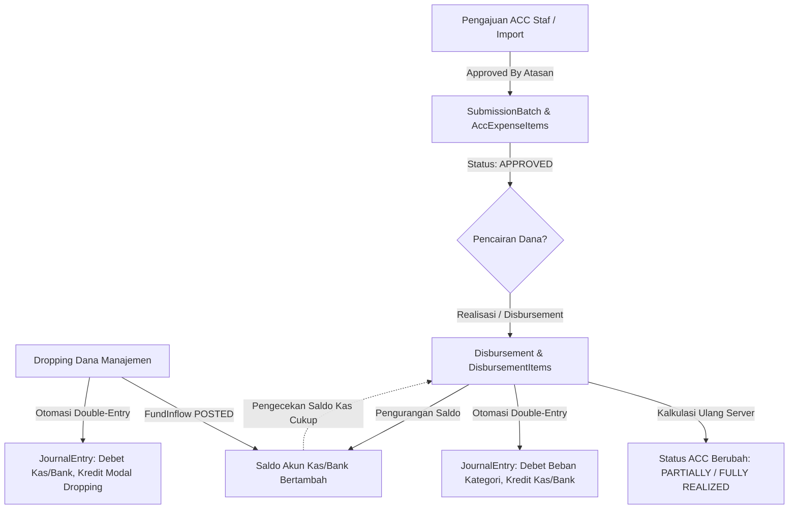
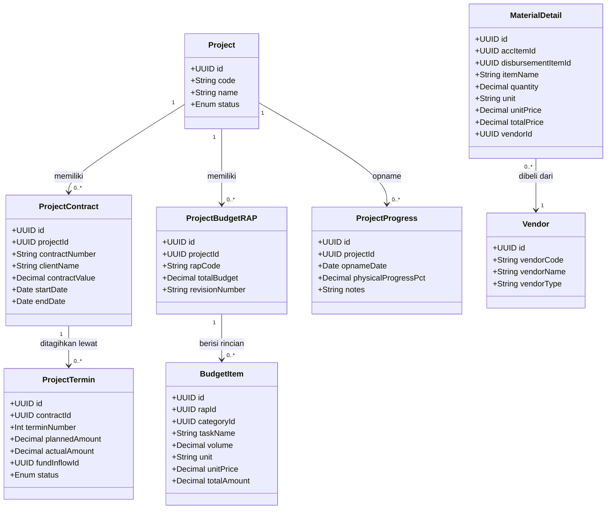
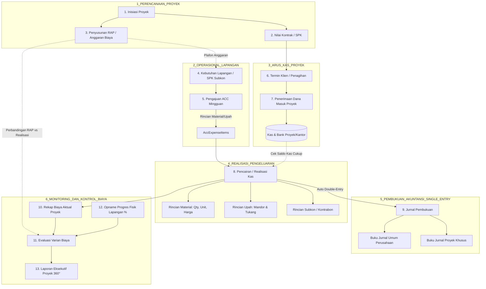

# ProTrack Phase 1 Audit
## Project Administration & Cost Control System Blueprint

> **Status:** AUDIT READ-ONLY & BLUEPRINT SEMENTARA  
> **Repository:** `C:\Marchelino Kurniawan\Project-2026\Admsystem`  
> **Git Remote:** `https://github.com/Acelinoo/System-Administrasi-Akuntansi.git`  
> **Production Financial Invariant:** LOCKED & IMMUTABLE (379 Batches REAL, 1.028 Items REAL, Rp4.303.052.418 ACC Approved, Rp0 Posted Disbursement, Rp0 Posted Inflow, 0 Posted Journals, Holding States Rp34.299.517 & 723 UNASSIGNED_MANDOR Intact).

---

## 1. Current Architecture

ProTrack saat ini beroperasi sebagai aplikasi web keuangan dan administrasi berbasis **Next.js 16 (App Router)** dengan **Turbopack**, **React 19**, **Prisma ORM 6**, dan **PostgreSQL (Neon Serverless)**.

### 1.1 Komponen Arsitektur Utama
- **Web Framework & UI Layer**: Next.js App Router dengan Server Components (RSC) untuk pemuatan data instan dan Client Components untuk interaktivitas formulir, modal, dan wizard.
- **Design System**: Monetira Financial Design System menggunakan Vanilla CSS murni (`src/app/globals.css`) dengan token desain off-white, kartu metrik finansial terstruktur, tipografi Inter & JetBrains Mono tabular, dan GSAP micro-interactions (`GsapMotion.tsx`).
- **Data Access & ORM**: Prisma ORM dengan koneksi ganda (`DATABASE_URL` untuk pooling aplikasi via pgbouncer dan `DIRECT_URL` untuk session migration langsung).
- **Service Layer (`src/lib/`)**:
  - `finance/`: Layanan transaksi inti (`acc.service.ts`, `disbursement.service.ts`, `inflow.service.ts`, `balance.service.ts`, `journal.service.ts`, `import.service.ts`, `real-bulk-importer.ts`, `no-kas.ts`).
  - `reports/`: Layanan kompilasi laporan finansial (`acc-report.service.ts`, `realization-report.service.ts`, `project-report.service.ts`, `pic-report.service.ts`, `cash-report.service.ts`, `journal-report.service.ts`).
  - `export/`: Generator berkas unduhan spreadsheet (`excel-export.service.ts` via ExcelJS) dan dokumen cetak resmi (`pdf-export.service.ts` via jsPDF & autoTable).
  - `validation/`: Skema validasi input berbasis Zod (`acc.schema.ts`, `disbursement.schema.ts`, `inflow.schema.ts`).
- **Server Actions Layer (`src/app/actions/`)**: Menyediakan bridge mutations dan query revalidasi terisolasi (`acc.actions.ts`, `disbursement.actions.ts`, `inflow.actions.ts`, `journal.actions.ts`, `master.actions.ts`, `pic.actions.ts`, `import.actions.ts`).

---

## 2. Current Database Model

Skema Prisma aktif (`prisma/schema.prisma`) terdiri dari **15 Model** dan **12 Enum** relasional dengan integritas referensial ketat (`ON DELETE RESTRICT`):

### 2.1 Model Relasional Aktif
1. `User`: Akun pengguna internal dan pencatatan audit pembuat transaksi (`STAFF`, `ADMIN`).
2. `CashSequence`: Generator nomor kas atomik thread-safe berbasis PostgreSQL row lock untuk prefix `KU` dan `KT` per tahun.
3. `Project`: Master proyek induk (`code`, `name`, `description`, `confirmationStatus`, `possibleParentCode`, `isActive`).
4. `ProjectSubUnit`: Master sub-unit anak proyek (`projectId`, `code`, `name`) dengan composite unique constraint `(id, projectId)` untuk parent-child integrity.
5. `ExpenseCategory`: Kategori operasional umum (`UPAH`, `MATERIAL`, `KONTRABON`, `SUBKON`, `SEWA_ALAT`, `OPS_LAPANGAN`, `OPS_KANTOR`, `KASBON`, `TALANGAN`).
6. `ExpenseSubCategory`: Rincian subkategori dengan composite unique constraint `(id, categoryId)`.
7. `FieldPic`: Master penanggung jawab / koordinator lapangan (termasuk status isolasi `UNASSIGNED_MANDOR`).
8. `CashAccount`: Rekening penampung dana kas tunai (`CASH`) dan perbankan (`BANK`) dengan `openingBalance`.
9. `SubmissionBatch`: Header pengajuan ACC mingguan (`batchCode`, `noKas`, `accDate`, `approvedByName`, `administrativeSubmitter`, `dataScope`).
10. `AccExpenseItem`: Item transaksi pengajuan yang disetujui atasan (`noKas`, `cashType`, `projectId`, `subUnitId`, `categoryId`, `subCategoryId`, `picId`, `requestedAmount`, `approvedAmount`, `status`, `dataScope`, `assignmentStatus`).
11. `FundInflow`: Penerimaan drop dana manajemen/atasan (`inflowNumber`, `inflowDate`, `destinationAccountId`, `amount`, `sourceInfo`, `status`, `dataScope`).
12. `Disbursement`: Header realisasi pengeluaran kas (`disbursementNumber`, `disbursementDate`, `cashAccountId`, `paymentMethod`, `totalRealizedAmount`, `status`, `dataScope`).
13. `DisbursementItem`: Baris alokasi pencairan dana aktual terhadap item ACC (`disbursementId`, `accItemId`, `realizedAmount`).
14. `CoaAccount`: Master bagan akun akuntansi (`accountCode`, `accountName`, `accountType`, `normalBalance`).
15. `CategoryCoaMapping`: Pemetaan otomatis Kategori Biaya ke Akun Debet COA Beban (`5xxx` / `6xxx`).
16. `JournalEntry`: Header jurnal umum berpasangan (`journalNumber`, `entryDate`, `sourceType`, `sourceId`, `description`, `status`, `dataScope`) dengan constraint idempotensi `UNIQUE(sourceType, sourceId, status)`.
17. `JournalLine`: Baris pembukuan debet dan kredit berpasangan (`journalId`, `coaId`, `projectId`, `debit`, `credit`, `memo`).

---

## 3. Existing Financial Workflow

Alur transaksi finansial saat ini dibangun di atas 6 aturan emas (Golden Financial Invariants):



1. **Pemisahan 4 Konsep Nominal**:
   - `Requested Amount`: Draf usulan staf (opsional).
   - `Approved Amount`: Plafon sah persetujuan atasan ($> 0$), menjadi batas maksimal pembayaran.
   - `Realized Amount`: Nominal kas yang benar-benar dicairkan ke lapangan.
   - `Journal Amount`: Nominal yang dibukukan ke akuntansi (selalu sama dengan `Realized Amount`).
2. **Kalkulasi Saldo Kas Zero-Negative**:
   $\text{Saldo Akhir} = \text{Opening Balance} + \sum \text{Posted Inflows} - \sum \text{Posted Disbursements}$.
   Pencairan ditolak mutlak jika saldo kas tidak mencukupi.
3. **Multi-Tranche Partial Realization**:
   Item ACC dapat dicairkan bertahap dengan batas ketat $\sum \text{Realized} \le \text{Approved}$.
4. **Zero Client-Trust Calculation**:
   Server menghitung ulang total dari rincian item. Tidak ada manipulasi total di sisi klien.
5. **Idempotent Double-Entry Automation**:
   Setiap pencairan otomatis membukukan jurnal debet beban dan kredit kas/bank.
6. **Mekanisme Reversal VOID**:
   Data finansial `POSTED` tidak pernah dihapus secara hard-delete. Pembatalan dilakukan dengan status `VOID`, membalikkan saldo dan memulihkan status ACC seketika.

---

## 4. Existing Project Workflow

### 4.1 Kondisi Master Proyek Saat Ini
Saat ini entitas `Project` hanya bertindak sebagai **dimensi kategorisasi biaya** (*cost center look-up*):
- Master proyek dicatat pada tabel `projects` (`code`, `name`, `description`).
- Master sub-unit proyek dicatat pada tabel `project_sub_units` (`projectId`, `code`, `name`).
- Pada transaksi ACC (`AccExpenseItem`), staf memilih `projectId` dan `subUnitId`.

### 4.2 Keterbatasan Workflow Proyek Saat Ini
1. **Tidak Ada Nilai Kontrak Proyek**: Sistem tidak menyimpan informasi berapa nilai kontrak induk pemberi kerja (owner/klien) maupun subkon.
2. **Tidak Ada Anggaran Proyek (RAB / RAP)**: Tidak ada batas pagu anggaran rencana per item pekerjaan atau per proyek.
3. **Tidak Ada Termin Masuk Per Proyek**: `FundInflow` saat ini hanya mencatat dropping kas umum ke rekening kantor (`sourceInfo`), tanpa alokasi ke `projectId` tertentu atau termin penagihan klien.
4. **Halaman Proyek Terbatas pada Monitoring Rekap**:
   - Menu `/master/projects`: Hanya CRUD nama dan kode proyek/sub-unit.
   - Menu `/reports/projects`: Menampilkan agregasi biaya disetujui, terealisasi, dan outstanding berdasarkan kategori pengeluaran.
   - **Belum ada halaman detail proyek terpadu (Project 360° View)**.

---

## 5. Existing Journal Workflow

### 5.1 Mekanisme Pembentukan Jurnal Saat Ini
- Jurnal dibuat secara atomik dan otomatis dalam transaksi database saat pencairan (`Disbursement`) atau penerimaan dana (`FundInflow`) berstatus `POSTED`.
- Sumber data jurnal:
  - **Pencairan (Disbursement)**:
    - **DEBET**: Akun COA Beban yang dipetakan dari Kategori Operasional (`CategoryCoaMapping`), membawa `projectId: item.projectId` pada baris `JournalLine`.
    - **KREDIT**: Akun COA Kas/Bank asal pembayaran (`1101` Kas Tunai atau `1102` Bank). Baris kredit saat ini memiliki `projectId: null`.
  - **Penerimaan Dana (Fund Inflow)**:
    - **DEBET**: Akun COA Kas/Bank penerima (`1101`/`1102`).
    - **KREDIT**: Akun COA Modal Operasional (`3101`), `projectId: null`.

### 5.2 Hubungan Jurnal Umum dan Jurnal Proyek
- Di level skema database, tabel `journal_lines` **sudah memiliki kolom `projectId String? @db.Uuid`**.
- Hal ini membuktikan bahwa:
  - **Jurnal Umum** = Seluruh baris `JournalLine` yang aktif (`status = POSTED`).
  - **Jurnal Proyek** = Baris `JournalLine` yang memiliki `projectId = [id_proyek_tertentu]`.
- **Temuan Kunci**: Arsitektur yang ada **sudah mendukung Single-Entry**. Transaksi pencairan yang diinput satu kali di modul pengeluaran sudah otomatis terpecah ke akun beban dan menempelkan `projectId`. Tidak ada kebutuhan menginput jurnal proyek secara manual terpisah!
- **Kekurangan Saat Ini**: Menu `/reports/journals` dan `/journals` belum menyediakan filter pemilah berdasarkan `projectId`, sehingga user belum bisa melihat buku jurnal khusus untuk satu proyek tertentu.

---

## 6. Existing Reporting Workflow

Tersedia 6 modul laporan terstruktur di `src/lib/reports/`:
1. `getAccReport`: Rekapitulasi pengajuan ACC berdasarkan tanggal, proyek, kategori, PIC, status, dan no kas.
2. `getRealizationReport`: Laporan riwayat realisasi pencairan kas terhadap item ACC.
3. `getProjectReport`: Agregasi alokasi dana ACC, realisasi keluar, dan sisa outstanding per proyek dengan breakdown kategori.
4. `getPicReport`: Distribusi dan pertanggungjawaban dana per koordinator lapangan (PIC).
5. `getCashReport`: Arus kas penerimaan, pengeluaran, dan saldo akhir tiap akun kas/bank.
6. `getJournalReport`: Buku jurnal umum double-entry (menampilkan tanggal, no jurnal, akun COA, debet, kredit, dan memo).

Seluruh laporan mendukung:
- Pemfilteran tanggal rentang (`startDate` & `endDate`).
- Pemfilteran DataScope terisolasi (`REAL` vs `TEST`).
- Ekspor multi-format (Excel berformat rapih via `excel-export.service.ts` dan dokumen cetak formal PDF via `pdf-export.service.ts`).

---

## 7. Existing UI / Routes

| Rute URL | Tipe | Deskripsi & Fungsi Saat Ini |
| :--- | :--- | :--- |
| `/` | Page (RSC) | Dashboard Finansial: 4 kartu metrik hero, status ACC, saldo kas/bank, tabel transaksi terbaru, top outstanding. |
| `/acc` | Page (RSC) | Daftar transaksi ACC dengan pencarian, filter status, proyek, pagination, dan metrik alokasi. |
| `/acc/new` | Page (RSC) | Formulir pencatatan pengajuan ACC baru (multi-item per voucher, penomoran atomik KU/KT). |
| `/acc/[id]` | Page (RSC) | Detail batch pengajuan ACC beserta rincian item pengeluaran dan status realisasinya. |
| `/acc/import` | Page (Client) | Wizard impor Excel terkontrol: mendukung format multi-sheet Rekap 2026 asli dan Template Standar. |
| `/inflows` | Page (RSC) | Daftar riwayat penerimaan drop dana manajemen dengan formulir input modal. |
| `/disbursements` | Page (RSC) | Daftar riwayat pencairan dana operasional dengan status dan detail akun pembayaran. |
| `/disbursements/new` | Page (RSC) | Formulir pencairan kas baru: pemilihan item outstanding ACC, validasi saldo kas, partial payment. |
| `/disbursements/[id]` | Page (RSC) | Detail bukti pengeluaran kas (voucher disbursement) beserta tombol pembatalan (VOID). |
| `/journals` | Page (RSC) | Tampilan pembukuan jurnal umum double-entry terurut kronologis. |
| `/reports` | Page (RSC) | Hub navigasi ke 6 modul laporan formal. |
| `/reports/acc` | Page (RSC) | Laporan detail seluruh transaksi ACC dengan filter komprehensif. |
| `/reports/realization`| Page (RSC) | Laporan detail realisasi pencairan kas terhadap kewajiban ACC. |
| `/reports/projects` | Page (RSC) | Laporan monitoring anggaran per proyek (alokasi vs realisasi per kategori). |
| `/reports/pic` | Page (RSC) | Laporan pertanggungjawaban dana per PIC/Mandor lapangan. |
| `/reports/cash` | Page (RSC) | Laporan buku kas & bank per rekening penampung. |
| `/reports/journals` | Page (RSC) | Laporan jurnal umum akuntansi formal dengan penyeimbang debet-kredit. |
| `/pic` | Page (RSC) | Monitoring distribusi beban dan outstanding dana per penanggung jawab lapangan. |
| `/export` | Page (RSC) | Pusat unduh laporan gabungan berkas Excel dan PDF. |
| `/master` | Page (RSC) | Hub navigasi data master sistem. |
| `/master/projects` | Page (Client) | Pengelolaan master proyek induk dan sub-unit proyek. |
| `/master/categories`| Page (Client) | Pengelolaan kategori dan subkategori operasional. |
| `/master/pic` | Page (Client) | Pengelolaan nama PIC / mandor lapangan. |
| `/master/accounts` | Page (Client) | Pengelolaan rekening bank dan akun kas tunai. |
| `/master/coa` | Page (Client) | Pengelolaan bagan akun akuntansi (Chart of Accounts). |

---

## 8. Existing Tests

ProTrack memiliki rangkaian pengujian ketat (*Safety Test Suites*) yang dijalankan via `npm test` dengan **100% kelulusan**:
1. `tests/run-all-tests.ts`: Suite audit kalkulasi dasar, saldo kas, partial payment, dan double-entry balance.
2. `tests/phase5-consistency-audit.ts`: Konsistensi data nominal, formula saldo kas, dan ekspor.
3. `tests/phase7-e2e-consistency.ts`: Siklus hidup lengkap E2E (Input ACC → Drop Dana → Pencairan → Jurnal → Laporan → VOID Reversal).
4. `tests/phase8-import-safety.ts`: Validasi pengelompokan batch, keunikan No Kas, isolasi error baris, dan rollback transaksi.
5. `tests/phase8b-real-excel-audit.ts`: Pengujian struktur multi-item voucher dan de-duplikasi snapshot mingguan.
6. `tests/phase8c-bulk-import.ts`: Audit pemetaan master data riil (Proyek, Kategori, PIC).
7. `tests/phase8c1-reconciliation.ts`: Rekonsiliasi 1.050 baris kandidat dan pembuktian matematis integritas voucher.
8. `tests/phase8c2-business-confirmation.ts`: 1.472 assertion penguncian status holding bisnis (723 `UNASSIGNED_MANDOR`, Rp34.299.517 kandidat realisasi, 6 kandidat proyek).
9. `tests/phase8c3-final-reconciliation.ts`: 125 assertion immutability data production REAL (Rp4.303.052.418 approved, zero orphan records).
10. `tests/phase9-production-readiness.ts`: Verifikasi kesiapan aset produksi, penanganan error 404/500, dan healthcheck API.

---

## 9. Requirement Mapping

Analisis perbandingan antara kebutuhan bisnis baru dan kapabilitas sistem existing:

| Requirement Bisnis Baru | Existing Support | Partial | Missing | Catatan & Analisis Arsitektur |
| :--- | :---: | :---: | :---: | :--- |
| **Project-Centric Navigation** | | ✓ | | Entitas `Project` ada, namun baru sebatas cost-center look-up. Belum ada halaman Project 360° yang merangkum kontrak, termin, RAP, realisasi, dan progres. |
| **Nilai Kontrak Proyek** | | | ✓ | Belum ada entitas penyimpanan nilai kontrak induk owner maupun nilai kontrak subkon (seperti pada workbook Alfacentauri). |
| **RAB / RAP Proyek** | | | ✓ | Belum ada struktur penyimpanan Rencana Anggaran Biaya / Rencana Anggaran Pelaksanaan (seperti pada workbook Kawaluyaan). |
| **Identifikasi Kebutuhan Proyek** | | ✓ | | Pengajuan ACC saat ini langsung mencatat `AccExpenseItem`. Tahap usulan kebutuhan pra-ACC belum terpisah. |
| **Pengajuan / ACC** | ✓ | | | **Fully Supported**. Didukung oleh `SubmissionBatch` & `AccExpenseItem` dengan status lifecycle lengkap. |
| **Dana Masuk / Termin Proyek** | | ✓ | | `FundInflow` sudah ada untuk kas masuk umum, tetapi **belum memiliki relasi ke Project** atau penagihan termin kontrak klien. |
| **Pencairan / Pengeluaran** | ✓ | | | **Fully Supported**. Didukung oleh `Disbursement` dan `DisbursementItem` dengan partial realization dan saldo guard. |
| **Detail Material (Qty, Satuan, Harga)**| | | ✓ | Saat ini material hanya dicatat sebagai teks pada `description` dan total pada `approvedAmount`/`realizedAmount`. Struktur rincian (volume, unit, harga satuan) belum ada. |
| **Detail Upah Mandor & Tukang** | | ✓ | | Kategori `UPAH` dan relasi `FieldPic` sudah ada, namun rincian hari kerja / jumlah tenaga kerja belum memiliki tabel rincian tersendiri. |
| **Vendor / Subkon & Kontrabon** | | ✓ | | Kategori `KONTRABON` dan `SUBKON` sudah ada di master, namun belum ada master entitas Vendor/Subkon dan nomor register penagihan kontrabon. |
| **Single-Entry Transaction** | ✓ | | | **Fully Supported di Core**. Satu transaksi pencairan otomatis memicu pembukuan akuntansi dan agregasi laporan tanpa input ganda. |
| **Jurnal Umum Otomatis** | ✓ | | | **Fully Supported**. Menghasilkan baris debit beban dan kredit kas/bank yang selalu seimbang. |
| **Jurnal Proyek Otomatis** | | ✓ | | `journal_lines` **sudah memiliki kolom `projectId`** pada sisi debit. Hanya memerlukan filter UI/report per proyek dan alokasi kredit kas proyek. |
| **Rekap Biaya per Proyek** | ✓ | | | Didukung oleh `/reports/projects`, namun perlu ditingkatkan untuk membandingkan realisasi terhadap anggaran RAP. |
| **Monitoring Progres Fisik Lapangan** | | | ✓ | Belum ada modul pelaporan volume fisik lapangan (target volume, realisasi m², % progres). |
| **Kontrol Biaya (Biaya vs Progres)** | | | ✓ | Belum ada komparasi antara % serapan biaya (cost burn rate) dengan % progres fisik pekerjaan. |

---

## 10. Proposed Domain Model

Untuk mengakomodasi alur bisnis baru **tanpa merusak financial core yang sudah berjalan**, berikut adalah rancangan model domain terintegrasi:



### Penjelasan Domain:
1. **Root Domain — `Project`**: Pusat agregasi seluruh dokumen finansial, administratif, dan teknis lapangan.
2. **Revenue & Client Domain — `ProjectContract` & `ProjectTermin`**:
   - Menyimpan nilai kontrak resmi pemberi kerja.
   - `ProjectTermin` menghubungkan jadwal penagihan termin ke transaksi kas masuk (`FundInflow`).
3. **Budgeting & Cost Control Domain — `ProjectBudgetRAP` & `BudgetItem`**:
   - Menyimpan Rencana Anggaran Pelaksanaan (RAP) per proyek dan per sub-unit.
   - Menjadi dasar plafon pembanding terhadap realisasi biaya yang keluar.
4. **Execution & Technical Domain — `ProjectProgress`**:
   - Menyimpan data opname lapangan periodik (target volume, capaian volume, % progres fisik kumulatif).
5. **Itemized Transaction Details — `MaterialDetail` & `Vendor`**:
   - Ekstensi opsional dari transaksi pengeluaran untuk mencatat rincian material (semen, besi, cat) beserta kuantitas, satuan, harga satuan, dan toko/supplier penyedia.

---

## 11. Data Flow

Diagram alur data Single-Entry dari hulu (kontrak) ke hilir (laporan & kontrol biaya):



---

## 12. Potential Schema Changes

Berikut adalah klasifikasi perubahan skema yang direncanakan:

### 12.1 REUSE (Pertahankan Utuh Tanpa Perubahan)
- `SubmissionBatch`: Header batch pengajuan ACC tetap menjadi wadah verifikasi atasan.
- `AccExpenseItem`: Core item ACC tetap memegang kendali atas `approvedAmount` dan status lifecycle `AccStatus`.
- `Disbursement` & `DisbursementItem`: Header dan alokasi pencairan multi-tranche tetap menjadi sumber kebenaran kas keluar.
- `CashAccount`: Rekening penampung dana kas dan bank tetap menjadi acuan saldo operasional.
- `CashSequence`: Generator nomor bukti transaksi `KU` dan `KT` tetap atomik.
- `CoaAccount` & `CategoryCoaMapping`: Bagan akun dan pemetaan debet-kredit akuntansi tetap menjadi dasar pembukuan double-entry.
- `JournalEntry`: Header jurnal akuntansi tetap memegang constraint idempotensi transaksi.

### 12.2 EXTEND (Penambahan Kolom Bersifat Nullable / Non-Destructive)
1. `projects`:
   - Tambahkan: `clientName String?`
   - Tambahkan: `contractValue Decimal? @db.Decimal(15, 2)`
   - Tambahkan: `targetStartDate DateTime? @db.Date`
   - Tambahkan: `targetEndDate DateTime? @db.Date`
   - Tambahkan: `status ProjectStatus @default(ACTIVE)` (Enum: `DRAFT`, `ACTIVE`, `COMPLETED`, `HOLD`)
2. `fund_inflows`:
   - Tambahkan: `projectId String? @db.Uuid` (agar penerimaan dana termin dapat diatribusikan langsung ke proyek terkait).
   - Tambahkan: `terminNumber Int?` (nomor termin penagihan klien).
3. `journal_lines`:
   - Pastikan sisi kredit kas/bank saat pencairan proyek dapat membawa `projectId` proyek bersangkutan secara opsional (agar Jurnal Proyek memiliki laporan debet dan kredit yang komplit).

### 12.3 NEW ENTITY (Entitas Baru Pendukung Fitur)
1. `ProjectContract`: Menyimpan rincian kontrak kerja, nomor SPK, addendum, dan termin penagihan.
2. `ProjectBudgetRap`: Menyimpan Rencana Anggaran Pelaksanaan (RAP) proyek per revisi.
3. `ProjectBudgetItem`: Rincian pos anggaran RAP (pekerjaan, volume, satuan, estimasi harga satuan, total pagu).
4. `ProjectTermin`: Jadwal dan realisasi penagihan termin owner/klien.
5. `MaterialExpenseDetail`: Rincian kuantitatif material (nama barang, merk, kuantitas, satuan, harga satuan) yang terhubung secara opsional ke `AccExpenseItem` dan `DisbursementItem`.
6. `ProjectProgressLog`: Log pencatatan opname fisik lapangan mingguan (persentase progres aktual, catatan kendala, tanggal opname).
7. `Vendor`: Master supplier toko bangunan, rekanan material, dan mandor/subkon borongan.

### 12.4 POSSIBLE DEPRECATION
- **Tidak ada entitas yang di-deprecate**. Seluruh tabel yang ada saat ini menyimpan data riil dan historis yang wajib dipertahankan.

---

## 13. Financial Core Risk Assessment

Bagian-bagian inti sistem keuangan yang **DIKUNCI SECARA MUTLAK (LOCKED & IMMUTABLE)**:

1. **Integritas Nominal Produksi**:
   - Total nominal ACC disetujui: **Rp4.303.052.418** (379 batch, 1.028 item).
   - Seluruh data historis ini tidak boleh tergeser, terhapus, atau ter-update nominalnya oleh fitur baru.
2. **Formula Saldo Kas & Guard Saldo Negatif**:
   - Formula $\text{Saldo} = \text{Opening} + \text{Inflow} - \text{Disbursement}$ pada `balance.service.ts` tidak boleh diubah menjadi formula berbasis akrual atau estimasi.
   - Pengecekan saldo kas cukup sebelum pencairan (`checkSufficientCash`) adalah pertahanan likuiditas utama.
3. **Status Holding Bisnis Phase 8C.2**:
   - 723 item dengan status `UNASSIGNED_MANDOR` tidak boleh dipaksa di-link ke mandor fiktif.
   - 4 baris kandidat realisasi senilai **Rp34.299.517** tetap berada pada status holding (belum diposting ke realisasi kas riil).
   - 6 proyek kandidat dengan status `REQUIRES_BUSINESS_CONFIRMATION` tetap terisolasi.
4. **Prinsip Double-Entry Balance**:
   - Seluruh baris jurnal wajib seimbang ($\sum \text{Debit} === \sum \text{Credit}$). Transaksi apapun yang menghasilkan jurnal tidak seimbang wajib dibatalkan secara atomik.

---

## 14. Migration Risk

Analisis risiko teknis jika penambahan fitur baru diterapkan ke database yang sedang berjalan:

| Skenario Perubahan | Tingkat Risiko | Dampak Potensial | Strategi Mitigasi Aman |
| :--- | :---: | :--- | :--- |
| **Penambahan Kolom Wajib (NOT NULL) pada Tabel Existing** | **KRITIS** | Seluruh operasi INSERT dan 1.028 baris data lama akan gagal validasi schema karena kolom baru bernilai null. | **Wajib NULLABLE** atau sediakan default value yang aman untuk seluruh kolom baru pada tabel existing. |
| **Pengubahan Tipe Data pada Kolom Finansial** | **KRITIS** | Kehilangan presisi angka desimal pada nominal rupiah atau gagal parsing pada laporan. | Pertahankan tipe `Decimal(15, 2)` pada seluruh representasi moneter. |
| **Menghubungkan Transaksi Lama ke RAP Baru** | **SEDANG** | Data historis 1.028 item tidak memiliki referensi RAP karena dibuat sebelum modul RAP ada. | Hubungan `BudgetItem` ke `AccExpenseItem` dibuat opsional (`NULLABLE`). Transaksi lama tetap valid tanpa item RAP. |
| **Penambahan Detail Material ke Item ACC** | **RENDAH** | Transaksi lama hanya memiliki deskripsi teks tanpa kuantitas/harga satuan terpisah. | Tabel `MaterialExpenseDetail` dibuat sebagai relasi 1-ke-banyak opsional. Item lama tetap valid tanpa baris material detail. |

---

## 15. Recommended Implementation Order

Urutan implementasi berjenjang yang direkomendasikan untuk pengembangan lanjutan:

```
[FASE 2: DOMAIN EXTENSION & MASTER DATA ENRICHMENT]
├── 1. Perluasan Master Project (Kontrak, Owner, Periode Pelaksanaan)
├── 2. Master Vendor & Subkontraktor
└── 3. Penambahan Dimensi Proyek pada Transaksi Penerimaan Dana (Inflow)
      ↓
[FASE 3: MODUL RAP & KONTROL ANGGARAN PROYEK]
├── 1. Pembuatan Skema & Layanan ProjectBudgetRAP & BudgetItem
├── 2. Antarmuka Penyusunan & Upload RAP Proyek
└── 3. Integrasi Pengecekan Plafon RAP pada Form Pengajuan ACC
      ↓
[FASE 4: RINCIAN PENGELUARAN (MATERIAL, UPAH, SUBCON)]
├── 1. Entitas & Formulir Rincian Material (Volume, Satuan, Harga Satuan, Vendor)
├── 2. Rincian Penagihan Kontrabon Subkon
└── 3. Single-Entry Flow: Input Rincian → Rekapitulasi Otomatis ke ACC & Disbursement
      ↓
[FASE 5: JURNAL PROYEK & MONITORING PROGRES]
├── 1. Pelengkapan Dimensi Project pada Baris Jurnal Akuntansi
├── 2. Halaman & Laporan Khusus "Jurnal Proyek" Terpisah
├── 3. Modul Pencatatan Opname Progres Fisik Lapangan (%)
└── 4. Dashboard Project 360° View (Kontrak vs Termin vs RAP vs Biaya Aktual vs Progres)
```

---

## 16. Open Questions

Pertanyaan bisnis yang belum dapat disimpulkan secara definitif dari repositori/data saat ini dan memerlukan konfirmasi pengguna/manajemen:

1. **Mekanisme Termin vs Dropping Kas**:
   Apakah penerimaan termin penagihan dari owner proyek disetorkan ke rekening kas/bank umum kantor terlebih dahulu sebelum di-dropping ke proyek, ataukah proyek memiliki rekening bank terpisah untuk masing-masing kontrak?
2. **Fleksibilitas Anggaran RAP**:
   Ketika pengajuan pengeluaran di lapangan melebihi estimasi biaya per pos pada RAP, apakah sistem harus **memblokir transaksi secara kaku (*Hard Budget Ceiling*)** ataukah **mengizinkan dengan notifikasi peringatan over-budget (*Soft Warning*)**?
3. **Format Pengukuran Progres Fisik**:
   Apakah persentase progres pekerjaan lapangan dihitung murni dari pembobotan volume item pekerjaan (seperti pada RAB/Kurva-S), ataukah berupa penilaian persentase akumulatif global mingguan dari mandor/pengawas lapangan?
4. **Status Penagihan Kontrabon**:
   Apakah kontrabon subkon/toko material diperlakukan sebagai pencatatan hutang usaha resmi (*Accounts Payable*) terlebih dahulu saat invoice diterima, ataukah baru dicatat saat pengajuan ACC diterbitkan?
