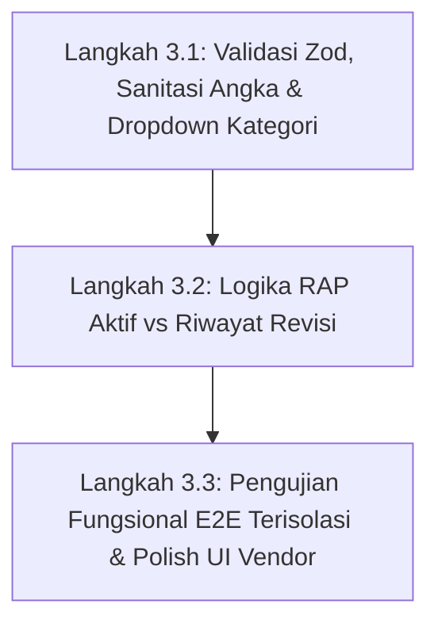

# ProTrack Phase 3 Audit
## Audit Gap Proyek, Kontrak, dan RAP/RAB (Rencana Anggaran Pelaksanaan)

> **Status Dokumen:** AUDIT TEKNIS & ANALISIS GAP (READ-ONLY)  
> **Repository:** `C:\Marchelino Kurniawan\Project-2026\Admsystem`  
> **Branch Aktif:** `main` (Ahead 2 commits dari origin, 2 files unstaged)  
> **Production Financial Invariant:** LOCKED & IMMUTABLE (379 Batches REAL, 1.028 Items REAL, Rp4.303.052.418 ACC Approved, Rp0 Posted Disbursement REAL, Rp0 Posted Inflow REAL).  
> **Waktu Audit:** 9 Oktober 2026  

---

## 1. Ringkasan Kondisi Aktual

Fase 2 (*Full Business Expansion*) telah menambahkan kapabilitas Project 360° pada commit `86c63bd`. Terakhir, pekerjaan difokuskan pada perbaikan tampilan modal pembuatan RAP/RAB di antarmuka tab Anggaran detail proyek.

### 1.1 Status Database & Data Historis Aktual
Pemeriksaan *read-only* langsung terhadap basis data PostgreSQL (Neon Serverless) menunjukkan:
* **Total Proyek Aktif:** Terdapat **12 proyek** di dalam sistem (`ALCENT`, `SUMEDANG`, `KAWALUYAAN`, `RT_BU_ANI`, `TANGGERANG`, `INTERNAL`, `DARUL_ULUM`, `BUDI_INDAH`, `APARTEMEN`, `ANTAPANI`, `CIREBON`, `JL_GITAR`).
* **Nilai Kontrak Historis:** Seluruh 12 proyek saat ini memiliki `contractValue: null` dan `clientName: null`. Data historis dari Excel impor tidak memuat nilai kontrak, dan sistem secara benar membiarkannya `null` tanpa mengarang angka palsu.
* **Tipe Proyek Historis:** Seluruh 12 proyek saat ini memiliki `projectType: "KONTRAKTOR"` (karena nilai default skema Prisma saat migrasi awal), termasuk proyek `INTERNAL` (Operasional Internal Kantor).
* **Data Anggaran RAP Riil:** Terdapat **0 record `ProjectBudget`** pada data REAL. Tidak ada data dummy anggaran yang pernah disimpan ke database produksi.
* **Integritas ACC Transaksi:** Seluruh 12 proyek memiliki riwayat transaksi pengeluaran ACC nyata (total 1.028 item senilai Rp4.303.052.418).

### 1.2 Status Kode & UI Terkini
* Komponen modal RAP/RAB di [src/app/projects/[id]/Project360Client.tsx](file:///c:/Marchelino%20Kurniawan/Project-2026/Admsystem/src/app/projects/%5Bid%5D/Project360Client.tsx#L1379-L1495) telah diperbaiki dengan tata letak Monetira Design System, latar putih bersih, dialog terpusat, backdrop blur, alur 2 tahap (Tahap 1 Penetapan Versi vs Tahap 2 Rincian Item Pos), tombol tutup `✕`, dan keyboard handler `Escape`.
* Layanan backend service [src/lib/finance/project-360.service.ts](file:///c:/Marchelino%20Kurniawan/Project-2026/Admsystem/src/lib/finance/project-360.service.ts) telah lolos 31 tes integrasi mandiri di lingkungan pengujian.
* Namun, pengujian penyimpanan RAP dan penambahan item **langsung dari formulir browser pengguna** belum pernah dieksekusi pada data REAL guna mematuhi aturan isolasi audit.

---

## 2. Inventaris Fitur yang Sudah Ada

Berikut adalah inventaris menyeluruh seluruh komponen Proyek, Kontrak, RAP/RAB, dan Laporan beserta status keterujiannya:

| No | Komponen / Fitur | Lokasi Kode Sumber | Status | Catatan Teknis |
| :---: | :--- | :--- | :---: | :--- |
| 1 | **Model Prisma Proyek (`Project`)** | [prisma/schema.prisma:131-157](file:///c:/Marchelino%20Kurniawan/Project-2026/Admsystem/prisma/schema.prisma#L131-L157) | **TERBUKTI BERFUNGSI** | Memuat `code`, `name`, `clientName`, `contractValue`, `projectType`, `targetStartDate`, `targetEndDate`. |
| 2 | **Model Sub-Unit Proyek (`ProjectSubUnit`)** | [prisma/schema.prisma:159-175](file:///c:/Marchelino%20Kurniawan/Project-2026/Admsystem/prisma/schema.prisma#L159-L175) | **TERBUKTI BERFUNGSI** | Composite unique `(id, projectId)` dan `(projectId, code)`. |
| 3 | **Model Header RAP (`ProjectBudget`)** | [prisma/schema.prisma:511-526](file:///c:/Marchelino%20Kurniawan/Project-2026/Admsystem/prisma/schema.prisma#L511-L526) | **SUDAH ADA TAPI BERMASALAH** | Relasi cascade ke `Project`. Namun tidak memiliki kolom `version: Int` atau `status/isActive`. |
| 4 | **Model Rincian Pos RAP (`BudgetItem`)** | [prisma/schema.prisma:528-545](file:///c:/Marchelino%20Kurniawan/Project-2026/Admsystem/prisma/schema.prisma#L528-L545) | **TERBUKTI BERFUNGSI** | Memuat `itemCode`, `description`, `category`, `volume`, `unit`, `unitPrice`, `totalAmount`. |
| 5 | **Model Termin Penagihan (`ProjectTermin`)** | [prisma/schema.prisma:551-573](file:///c:/Marchelino%20Kurniawan/Project-2026/Admsystem/prisma/schema.prisma#L551-L573) | **TERBUKTI BERFUNGSI** | Relasi opsional `fundInflowId` ke `FundInflow`. |
| 6 | **Model Log Progres Fisik (`ProjectProgressLog`)** | [prisma/schema.prisma:579-595](file:///c:/Marchelino%20Kurniawan/Project-2026/Admsystem/prisma/schema.prisma#L579-L595) | **TERBUKTI BERFUNGSI** | Mencatat opname fisik lapangan sipil (`physicalProgressPct`). |
| 7 | **Model SPK Vendor/Subkon (`VendorContract`)** | [prisma/schema.prisma:630-650](file:///c:/Marchelino%20Kurniawan/Project-2026/Admsystem/prisma/schema.prisma#L630-L650) | **TERBUKTI BERFUNGSI** | Relasi ke `Vendor` dan opsional ke `Project`. |
| 8 | **Service `createProjectBudget`** | [src/lib/finance/project-360.service.ts:369-423](file:///c:/Marchelino%20Kurniawan/Project-2026/Admsystem/src/lib/finance/project-360.service.ts#L369-L423) | **TERBUKTI BERFUNGSI** | Lulus unit test. Menghitung `totalBudget` awal dan batch items. |
| 9 | **Service `addBudgetItem`** | [src/lib/finance/project-360.service.ts:425-464](file:///c:/Marchelino%20Kurniawan/Project-2026/Admsystem/src/lib/finance/project-360.service.ts#L425-L464) | **TERBUKTI BERFUNGSI** | Menggunakan `$transaction` dan otomatis mengkalkulasi ulang `totalBudget` induk. |
| 10 | **Service `deleteBudgetItem`** | [src/lib/finance/project-360.service.ts:466-485](file:///c:/Marchelino%20Kurniawan/Project-2026/Admsystem/src/lib/finance/project-360.service.ts#L466-L485) | **TERBUKTI BERFUNGSI** | Menghapus item pos dan merekalibrasi total anggaran header. |
| 11 | **Service `getProject360Data`** | [src/lib/finance/project-360.service.ts:38-364](file:///c:/Marchelino%20Kurniawan/Project-2026/Admsystem/src/lib/finance/project-360.service.ts#L38-L364) | **SUDAH ADA TAPI BERMASALAH** | Menghitung metrik finansial, namun **menjumlahkan seluruh versi RAP** alih-alih mengambil versi aktif. |
| 12 | **Server Action `createProjectBudgetAction`** | [src/app/actions/project-360.actions.ts:16-49](file:///c:/Marchelino%20Kurniawan/Project-2026/Admsystem/src/app/actions/project-360.actions.ts#L16-L49) | **SUDAH ADA TAPI BELUM TERVERIFIKASI** | Belum diuji E2E dari browser pada data riil. |
| 13 | **Server Action `addBudgetItemAction`** | [src/app/actions/project-360.actions.ts:51-87](file:///c:/Marchelino%20Kurniawan/Project-2026/Admsystem/src/app/actions/project-360.actions.ts#L51-L87) | **SUDAH ADA TAPI BELUM TERVERIFIKASI** | Belum diuji E2E dari browser pada data riil. Mengandung bug parsing volume `0`. |
| 14 | **Validasi Zod untuk Budget/Proyek** | [src/lib/validation/](file:///c:/Marchelino%20Kurniawan/Project-2026/Admsystem/src/lib/validation/) | **BELUM ADA** | Hanya ada `acc.schema.ts`, `disbursement.schema.ts`, `inflow.schema.ts`. Proyek/RAP masih validasi manual. |
| 15 | **UI Modal Buat Versi RAP (Tahap 1)** | [src/app/projects/[id]/Project360Client.tsx:1379-1495](file:///c:/Marchelino%20Kurniawan/Project-2026/Admsystem/src/app/projects/%5Bid%5D/Project360Client.tsx#L1379-L1495) | **TERBUKTI BERFUNGSI (VISUAL)** | Terbuka di tengah layar, styling rapi, alur 2 tahap jelas, anti-double submit. |
| 16 | **UI Modal Tambah Item Pos (Tahap 2)** | [src/app/projects/[id]/Project360Client.tsx:1498-1605](file:///c:/Marchelino%20Kurniawan/Project-2026/Admsystem/src/app/projects/%5Bid%5D/Project360Client.tsx#L1498-L1605) | **TERBUKTI BERFUNGSI (VISUAL)** | Form modal terbuka rapi, namun input kategori masih berupa text input bebas. |
| 17 | **Mekanisme Seleksi Versi RAP Aktif** | - | **BELUM ADA** | Tidak ada flag/kolom penentu versi mana yang menjadi acuan utama. |
| 18 | **Fitur Edit / Hapus Header RAP** | - | **BELUM ADA** | Tidak ada server action maupun tombol untuk mengubah atau menghapus versi RAP yang keliru dibuat. |
| 19 | **Laporan Rekapitulasi Proyek Web** | [src/app/reports/projects/page.tsx:80-210](file:///c:/Marchelino%20Kurniawan/Project-2026/Admsystem/src/app/reports/projects/page.tsx#L80-L210) | **SUDAH ADA TAPI BERMASALAH** | Tabel laporan belum memuat kolom Pagu RAP dan Sisa Anggaran RAP. |
| 20 | **Ekspor Excel/PDF Proyek** | [src/lib/export/excel-export.service.ts:274-340](file:///c:/Marchelino%20Kurniawan/Project-2026/Admsystem/src/lib/export/excel-export.service.ts#L274-L340) | **SUDAH ADA TAPI BERMASALAH** | Berkas Excel dan PDF belum menyertakan kolom Pagu Anggaran RAP. |

---

## 3. Matriks Kebutuhan Bisnis versus Implementasi

| No | Kebutuhan Bisnis Fase 3 | Status | Evaluasi Implementasi Aktual |
| :---: | :--- | :---: | :--- |
| 1 | **Klasifikasi Jenis Proyek (Kontraktor, Konsultan, Internal)** | **SUDAH ADA TAPI BELUM LENGKAP** | Kolom `projectType` ada di database. Dapat diubah melalui modal *Edit Kontrak & Klasifikasi* di Project 360 ([Project360Client.tsx:1317](file:///c:/Marchelino%20Kurniawan/Project-2026/Admsystem/src/app/projects/%5Bid%5D/Project360Client.tsx#L1317)). Namun pada form Master Proyek ([master.actions.ts:62](file:///c:/Marchelino%20Kurniawan/Project-2026/Admsystem/src/app/actions/master.actions.ts#L62)), field ini belum tersedia saat create/edit. |
| 2 | **Pencatatan Nilai Kontrak Tanpa Mengarang** | **TERBUKTI BERFUNGSI** | `contractValue` bersifat opsional (`Decimal?`, default `null`). Data historis tanpa kontrak tetap berstatus `null` dan ditampilkan sebagai `-` tanpa memaksa nilai 0 atau angka semu. |
| 3 | **Identitas Versi RAP/RAB yang Jelas** | **SUDAH ADA TAPI BERMASALAH** | Identitas versi saat ini hanya berupa field teks bebas `title` (contoh: "RAP Pelaksanaan Awal 2026"). Tidak ada penomoran versi terstruktur (`version: Int`) atau status resmi (`ACTIVE`, `ARCHIVED`). |
| 4 | **Item RAP Mendukung Uraian, Volume, Satuan, Harga, Total** | **TERBUKTI BERFUNGSI** | Model `BudgetItem` memuat field lengkap dan mengkalkulasi `totalAmount = volume * unitPrice` dengan pembulatan dua desimal (`Math.round(... * 100) / 100`). |
| 5 | **Revisi RAP Mempertahankan Riwayat Versi Terdahulu** | **TERBUKTI BERFUNGSI** | Setiap kali versi RAP baru dibuat, record tersimpan sebagai entitas baru tanpa menimpa atau menghapus versi lama di database. |
| 6 | **Anggaran Sebagai Alat Monitoring (Bukan Pemblokir Transaksi)** | **TERBUKTI BERFUNGSI** | Status varians biaya menghasilkan sinyal `"HEALTHY"`, `"WARNING"`, atau `"OVERBUDGET"`. Transaksi pengajuan ACC dan pencairan kas tidak diblokir secara otomatis oleh sistem. |
| 7 | **Biaya Aktual Berasal dari Transaksi Sah (Posted Realized)** | **TERBUKTI BERFUNGSI** | `totalPostedExpense` dihitung secara eksklusif dari baris pencairan dana (`disbursementItems`) dengan status `TransactionStatus.POSTED`. Nilai RAP tidak dijadikan biaya aktual. |
| 8 | **Termin Tidak Dianggap Kas Masuk Sebelum POSTED** | **TERBUKTI BERFUNGSI** | Termin dengan status `PLANNED` atau `INVOICED` tidak mempengaruhi saldo kas akun maupun metrik penerimaan. Hanya termin yang dicatat penerimaannya (`recordTerminPaymentAction`) yang menghasilkan `FundInflow` POSTED. |
| 9 | **Data Historis Tidak Lengkap Tetap Kompatibel** | **TERBUKTI BERFUNGSI** | Seluruh 12 proyek nyata tanpa kontrak dan tanpa RAP dapat dibuka, dihitung metriknya, dan ditampilkan pada laporan tanpa crash runtime atau pembagian nol (`null-safe`). |

---

## 4. Temuan Bug & Gap Teknis Beserta Bukti Kode

### GAP 1: Bug Agregasi Multi-Versi Anggaran (Double Counting Budget)
* **Tingkat Keparahan:** **TINGGI (Logika Finansial)**
* **Lokasi Kode:**
  * [src/lib/finance/project-360.service.ts:193-195](file:///c:/Marchelino%20Kurniawan/Project-2026/Admsystem/src/lib/finance/project-360.service.ts#L193-L195)
  * [src/lib/reports/project-report.service.ts:216-220](file:///c:/Marchelino%20Kurniawan/Project-2026/Admsystem/src/lib/reports/project-report.service.ts#L216-L220)
* **Bukti Kode:**
  ```typescript
  // src/lib/finance/project-360.service.ts
  const totalRapBudget = budgets.reduce((sum, b) => {
    return sum + b.items.reduce((itemSum, it) => itemSum + Number(it.totalAmount), 0);
  }, 0);
  ```
* **Dampak:** Jika staf membuat "RAP Versi 1" sebesar Rp 500.000.000, kemudian di kemudian hari membuat "RAP Revisi 2" sebesar Rp 600.000.000, fungsi `budgets.reduce` akan menjumlahkan kedua versi sehingga total anggaran proyek melonjak menjadi Rp 1.100.000.000. Sistem belum memiliki logika untuk mengambil **hanya satu versi aktif** (misalnya versi terbaru berdasarkan `createdAt` atau flag `isActive`).

---

### GAP 2: Inkonsistensi Kategori Pos Anggaran (String Bebas vs Master Category)
* **Tingkat Keparahan:** **SEDANG (UX & Akurasi Pemetaan)**
* **Lokasi Kode:**
  * Form UI: [src/app/projects/[id]/Project360Client.tsx:1545-1549](file:///c:/Marchelino%20Kurniawan/Project-2026/Admsystem/src/app/projects/%5Bid%5D/Project360Client.tsx#L1545-L1549)
  * Pemetaan Service: [src/lib/finance/project-360.service.ts:280-284, 303](file:///c:/Marchelino%20Kurniawan/Project-2026/Admsystem/src/lib/finance/project-360.service.ts#L280-L284)
* **Bukti Kode:**
  ```tsx
  // Di Project360Client.tsx:
  <input type="text" name="category" placeholder="Contoh: Material / Upah" className="form-control" />

  // Di project-360.service.ts:
  const catKey = it.category.toUpperCase().trim();
  rapCatMap.set(catKey, ...);
  // Dicocokkan dengan:
  const budgetAmount = rapCatMap.get(cat.code.toUpperCase().trim()) ?? 0;
  ```
* **Dampak:** Pada form modal, `category` diinput sebagai teks bebas dengan placeholder `"Contoh: Material / Upah"`. Jika staf mengetik `"Material / Upah"` atau `"Bahan Besi"`, kode tidak akan cocok dengan kode kategori master (`MATERIAL` atau `UPAH`). Akibatnya, pagu kategori di tabel *Rekap Biaya & Kontrol Pos* akan bernilai Rp 0. Padahal prop `lookups.categories` sudah tersedia di halaman detail proyek dan dapat langsung digunakan sebagai elemen `<select>`.

---

### GAP 3: Bug Falsy Volume `0` dan Ketiadaan Validasi Non-Negatif
* **Tingkat Keparahan:** **SEDANG (Validasi Input)**
* **Lokasi Kode:**
  * [src/app/actions/project-360.actions.ts:65-66](file:///c:/Marchelino%20Kurniawan/Project-2026/Admsystem/src/app/actions/project-360.actions.ts#L65-L66)
* **Bukti Kode:**
  ```typescript
  const volume = parseFloat(volumeRaw) || 1;
  const unitPrice = parseFloat(unitPriceRaw) || 0;
  ```
* **Dampak:**
  1. Jika staf menginput volume `0`, ekspresi JavaScript `0 || 1` akan mengevaluasi ke `1`, sehingga volume tersimpan sebagai 1 alih-alih ditolak atau dibiarkan 0.
  2. Tidak ada validasi nilai negatif. Jika staf memasukkan `-5` atau harga `-100000`, backend akan menerimanya dan menghasilkan pagu anggaran negatif di database.

---

### GAP 4: Ketiadaan Skema Zod Terpusat untuk Proyek & RAP
* **Tingkat Keparahan:** **SEDANG (Standar Arsitektur)**
* **Lokasi Kode:**
  * Direktori [src/lib/validation/](file:///c:/Marchelino%20Kurniawan/Project-2026/Admsystem/src/lib/validation/)
* **Dampak:** Modul transaksi lain (`acc`, `disbursement`, `inflow`) memiliki skema Zod terpusat yang ketat (`acc.schema.ts`, dll.). Sementara itu, mutasi RAP dan Proyek 360 masih melakukan validasi manual string di dalam file Server Actions tanpa sanitasi tipe data yang seragam.

---

### GAP 5: Ketiadaan Fitur Edit & Hapus Versi RAP
* **Tingkat Keparahan:** **SEDANG (Operasional Staf)**
* **Lokasi Kode:**
  * [src/app/actions/project-360.actions.ts](file:///c:/Marchelino%20Kurniawan/Project-2026/Admsystem/src/app/actions/project-360.actions.ts)
* **Dampak:** Saat ini hanya ada `deleteBudgetItemAction` (menghapus satu baris item pos). Tidak ada server action maupun tombol UI untuk menghapus seluruh versi RAP (`deleteProjectBudgetAction`) atau mengubah judul/catatan versi RAP (`updateProjectBudgetAction`). Jika staf salah membuat nama versi atau membuat draf keliru, versi tersebut tidak dapat diubah atau dihapus dari UI.

---

### GAP 6: Kolom Pagu RAP Belum Ditampilkan pada Laporan Rekapitulasi Proyek
* **Tingkat Keparahan:** **RENDAH (Kelengkapan Laporan)**
* **Lokasi Kode:**
  * Halaman Web: [src/app/reports/projects/page.tsx:90-105](file:///c:/Marchelino%20Kurniawan/Project-2026/Admsystem/src/app/reports/projects/page.tsx#L90-L105)
  * Ekspor Excel: [src/lib/export/excel-export.service.ts:286-296](file:///c:/Marchelino%20Kurniawan/Project-2026/Admsystem/src/lib/export/excel-export.service.ts#L286-L296)
  * Ekspor PDF: [src/lib/export/pdf-export.service.ts:290](file:///c:/Marchelino%20Kurniawan/Project-2026/Admsystem/src/lib/export/pdf-export.service.ts#L290)
* **Dampak:** Laporan proyek perbandingan saat ini hanya memuat kolom *Nilai Kontrak, Penerimaan, Biaya Keluar, Saldo Bersih, Progres Kas, Progres Fisik*. Kolom *Pagu RAP* dan *Sisa Anggaran RAP* belum dimasukkan ke dalam tabel ringkasan utama maupun berkas unduhan spreadsheet/PDF.

---

## 5. Risiko terhadap Data Historis dan Transaksi Keuangan

1. **Risiko terhadap Data REAL: NOL (Sangat Aman)**
   * Seluruh pembacaan data RAP dan kontrak bersifat isolatif.
   * Proyek historis yang tidak memiliki kontrak (`contractValue: null`) ditangani secara aman dengan nilai `null`, mencegah pembagian nol pada perhitungan persentase (`(totalInflow / contractValue) * 100`).
   * Tidak ada skrip seed atau migrasi destruktif yang berjalan pada database produksi.

2. **Risiko terhadap Transaksi Pengeluaran Keuangan: NOL (Tidak Memblokir)**
   * Penambahan fitur RAP tidak mengubah alur pencatatan pengajuan ACC (`AccExpenseItem`) maupun pencairan kas (`DisbursementItem`).
   * Peringatan over-budget hanya berupa label visual warna (`status-danger` / `OVERBUDGET`) dan tidak mengunci pembuatan voucher kas operasional.

---

## 6. Daftar Perbaikan yang Benar-Benar Diperlukan (Berdasarkan Prioritas)

### Prioritas 1 — Kritis (Logika & Konsistensi Finansial)
1. **Perbaiki Logika Pagu RAP Multi-Versi:**
   Ubah perhitungan `totalRapBudget` pada `project-360.service.ts` dan `project-report.service.ts` agar hanya mengambil **satu versi RAP aktif/terbaru** per proyek (atau versi dengan `createdAt` paling baru jika belum ada kolom status), sehingga revisi RAP tidak menduplikasi nilai pagu.
2. **Ubah Input Kategori Pos Anggaran Menjadi Pilihan Dropdown:**
   Pada modal *Tambah Pos Item RAP*, ganti `<input type="text" name="category">` menjadi `<select name="category">` menggunakan data dari `lookups.categories`. Dengan demikian nilai kategori selalu selaras dengan kode `ExpenseCategory` untuk rekapitulasi varians biaya.
3. **Validasi Angka Positif & Non-Zero pada Item Anggaran:**
   Tambahkan validasi bahwa `volume > 0` dan `unitPrice >= 0` di sisi server action sebelum item pos disimpan ke database.

### Prioritas 2 — Penting (Operasional Staf & Standar Kode)
4. **Buat Skema Validasi Zod Terpusat (`project.schema.ts`):**
   Satukan validasi input pembuatan RAP, item RAP, dan pembaruan kontrak proyek menggunakan Zod di [src/lib/validation/](file:///c:/Marchelino%20Kurniawan/Project-2026/Admsystem/src/lib/validation/).
5. **Tambahkan Aksi Hapus / Edit Header Versi RAP:**
   Sediakan server action dan kontrol UI untuk menghapus versi RAP yang salah atau memperbarui judul/catatannya.
6. **Sediakan Pilihan `projectType` pada Form Master Proyek:**
   Tambahkan field pilihan tipe proyek (*Kontraktor*, *Konsultan*, *Internal*) pada modal Tambah dan Edit Proyek di `/master/projects`.

### Prioritas 3 — Penyempurnaan (Visual & Laporan)
7. **Integrasikan Kolom Pagu RAP pada Laporan Per Proyek:**
   Tambahkan kolom Pagu Anggaran RAP dan Sisa RAP pada halaman [src/app/reports/projects/page.tsx](file:///c:/Marchelino%20Kurniawan/Project-2026/Admsystem/src/app/reports/projects/page.tsx) serta generator ekspor Excel dan PDF.

---

## 7. Rencana Implementasi Bertahap untuk Fase 3

Implementasi Fase 3 disarankan dibagi ke dalam 3 langkah bertahap tanpa downtime:



* **Langkah 3.1:**
  * Buat `src/lib/validation/project-budget.schema.ts`.
  * Perbaiki parsing volume dan harga satuan di `project-360.actions.ts`.
  * Hubungkan `lookups.categories` ke dropdown kategori pada modal item RAP di `Project360Client.tsx`.
* **Langkah 3.2:**
  * Sesuaikan service `project-360.service.ts` dan `project-report.service.ts` agar `totalRapBudget` mengambil versi RAP paling mutakhir (latest version) sebagai acuan pagu aktif proyek, sementara versi lama tetap ditampilkan di tabel riwayat RAP.
  * Tambahkan server action `deleteProjectBudgetAction`.
* **Langkah 3.3:**
  * Lakukan pengujian penyimpanan RAP dan penambahan item pos pada proyek dengan scope `TEST` terisolasi untuk membuktikan fungsionalitas end-to-end tanpa menyentuh data `REAL`.
  * Selaraskan modal SPK Vendor/Subkon agar memiliki hierarki visual yang sama rapinya dengan modal RAP.

---

## 8. Daftar Pengujian Manual yang Perlu Dilakukan Pengguna

Setelah implementasi Fase 3 dijalankan, staf administrasi disarankan melakukan verifikasi manual berikut melalui browser:

1. **Pengujian Pembuatan Versi RAP Pertama:**
   * Buka salah satu proyek (misal `ALCENT`).
   * Klik tab **Anggaran RAP/RAB**.
   * Klik tombol **Buat RAP Sekarang**.
   * Isi judul: `"RAP Pelaksanaan Awal 2026"`, catatan: `"ACC Direksi"`.
   * Klik **Buat Versi RAP**. Pastikan modal tertutup dan kartu versi RAP muncul dengan pagu Rp 0.
2. **Pengujian Penambahan Pos Item RAP:**
   * Pada kartu RAP yang baru terbuat, klik **Tambah Item Pekerjaan**.
   * Masukkan Uraian: `"Pekerjaan Pasangan Dinding"`, pilih Kategori: `"MATERIAL"`, Volume: `100`, Satuan: `"m2"`, Harga: `150.000`.
   * Simpan dan pastikan total pagu item muncul Rp 15.000.000, serta total header kartu otomatis berubah menjadi Rp 15.000.000.
3. **Pengujian Rekapitulasi Varians Kategori:**
   * Buka tab **Rekap Biaya & Kontrol Pos**.
   * Pastikan baris kategori `MATERIAL` kini memiliki nilai pagu anggaran sebesar Rp 15.000.000 dan menampilkan varians sisa anggaran terhadap biaya riil yang dikeluarkan.
4. **Pengujian Revisi Versi RAP Kedua:**
   * Klik tombol **+ Buat Versi RAP Baru** di kanan atas.
   * Buat `"RAP Revisi Addendum 1"`.
   * Tambahkan item pos.
   * Pastikan ringkasan metrik di bagian atas kartu metrik proyek menggunakan pagu versi aktif/terbaru, bukan menjumlahkan kedua versi sekaligus.

---

## 9. Daftar Pekerjaan untuk Fase 4 atau Fase 5

Fitur-fitur berikut di luar cakupan mendesak Fase 3 dan direkomendasikan dialokasikan pada fase selanjutnya:

* **Fase 4 (Laporan Eksekutif & Analisis Biaya Lanjutan):**
  * Penambahan kolom Pagu RAP dan Sisa Anggaran pada ekspor resmi Excel dan PDF.
  * Grafik visual perbandingan Kurva S (Progres Fisik Sipil vs Realisasi Kas Finansial vs Target Termin).
  * Filter multi-dimensi per sub-unit proyek di dalam laporan rekapitulasi.
* **Fase 5 (Otorisasi & Kontrol Internal Formal):**
  * Workflow persetujuan formal berjenjang (*Approval Gate*) untuk penguncian versi RAP resmi.
  * Riwayat log audit perubahan kontrak (*Contract Change Order / Addendum tracking*).

---

## 10. Kesimpulan Audit

Sistem administrasi proyek ProTrack saat ini telah memiliki fondasi skema dan service Project 360 yang sangat solid dan aman bagi data historis nyata. Modal UI pembuatan RAP telah berhasil diperbaiki secara visual dan interaktif.

Tiga fokus utama yang perlu diselesaikan pada implementasi teknis Fase 3 adalah:
1. **Memperbaiki logika agregasi multi-versi RAP** agar tidak terjadi *double-counting* anggaran.
2. **Menyediakan validasi ketat dan dropdown kategori** pada penambahan pos item RAP.
3. **Melakukan verifikasi end-to-end form submission** pada lingkungan pengujian yang aman.
